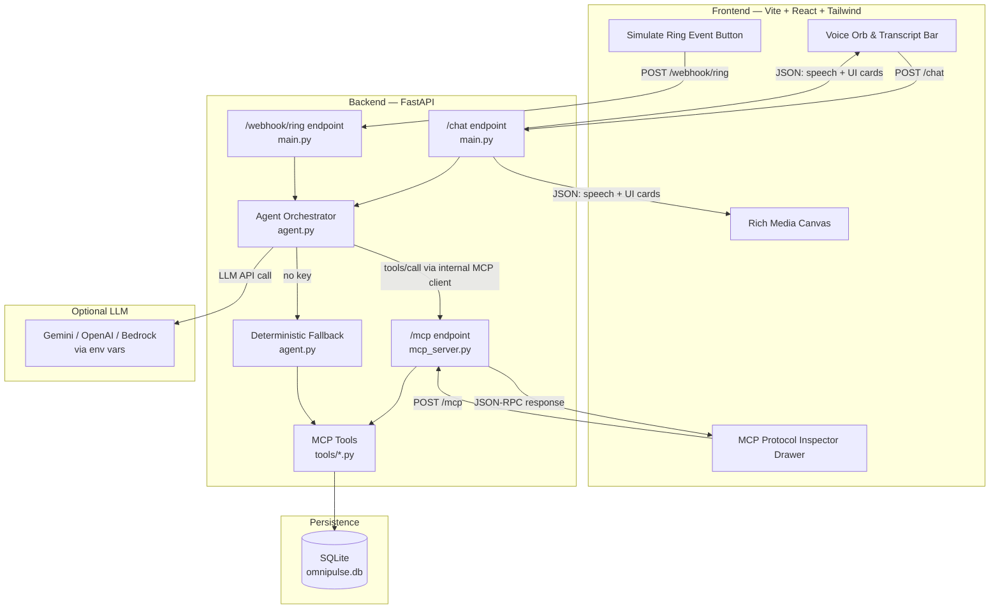
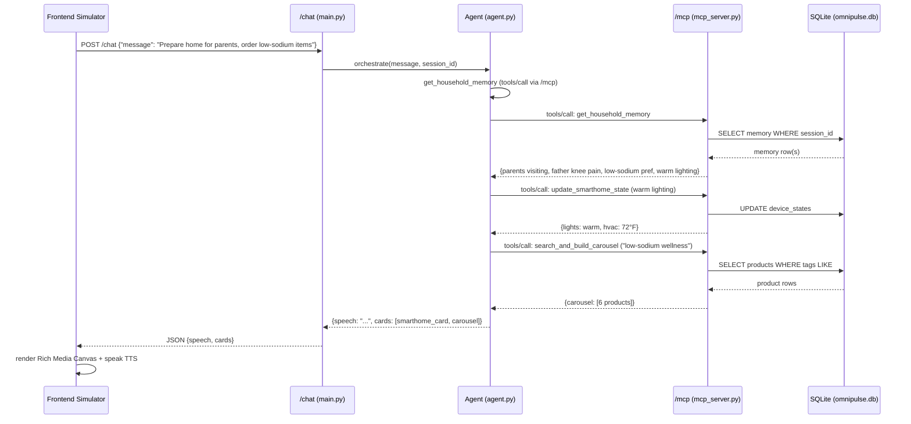
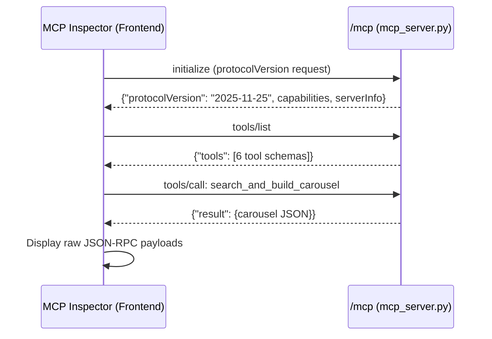
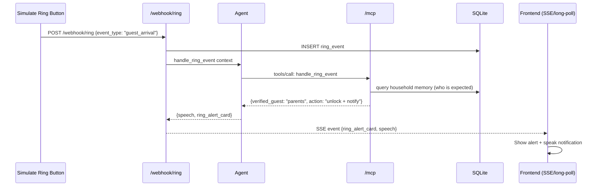

# Design Document: omnipulse-mvp (Alexa+ OmniPulse)

## Overview

Alexa+ OmniPulse is an autonomous, context-aware multi-service orchestrator built for the Amazon Developer Hackathon. It combines an open-standard Streamable HTTP MCP Server (spec `2025-11-25`), a LangGraph-style agent orchestrator with deterministic fallback, and an Echo Show-inspired web simulator. A single user command can trigger sequential and parallel MCP tool calls across Smart Home, Commerce, and Ring Security domains, returning both conversational speech text and structured JSON payloads that the simulator renders as interactive Product Carousels, Smart Home Status Cards, and 1-Click Checkout cards.

The system is designed for zero-config local execution by judges: SQLite (`omnipulse.db`) stores persistent cross-session household memory, cart state, and smart home device state; a deterministic smart-fallback agent lets the demo run without any LLM API key, while optional Gemini, OpenAI, or AWS Bedrock keys can be supplied via environment variables for richer natural-language orchestration.

The frontend is a dark-mode glassmorphic Echo Show 15 simulator built with Vite + React + Tailwind CSS + Lucide Icons. It makes real runtime HTTP requests to the `/mcp` and `/chat` endpoints, renders an animated voice orb with Web Speech API STT/TTS, dynamically renders rich media cards from MCP tool metadata, and includes a live MCP Protocol Inspector Drawer that displays the raw `initialize`, `tools/list`, and `tools/call` JSON-RPC payloads to prove runtime MCP compliance.

## Architecture

The system follows a three-layer architecture: a React frontend simulator, a FastAPI backend with an MCP Streamable HTTP server and an agent orchestrator, and a SQLite persistence layer. The frontend never calls tools directly; it sends user commands to `/chat`, which the agent orchestrates into MCP `tools/call` invocations on the backend's own `/mcp` endpoint. The MCP Protocol Inspector independently sends `initialize` / `tools/list` / `tools/call` directly to `/mcp` to visually prove protocol compliance.



### Request-Response Flow



### MCP Protocol Inspector Flow (Proof of Compliance)



### Ring Webhook Flow (Proactive Trigger)



## Components and Interfaces

### Component 1: MCP Server (`mcp_server.py`)

**Purpose**: Implements the MCP specification `2025-11-25` over Streamable HTTP, handling JSON-RPC 2.0 `initialize`, `tools/list`, and `tools/call` methods with optional SSE streaming responses.

**Interface**:

```python
class MCPServer:
    PROTOCOL_VERSION: str = "2025-11-25"

    def handle_initialize(self, request: MCPRequest) -> MCPInitializeResponse:
        """Returns protocolVersion, server capabilities, and server info."""

    def handle_tools_list(self, request: MCPRequest) -> MCPToolsListResponse:
        """Returns the 6 tool definitions with input schemas."""

    def handle_tools_call(self, request: MCPRequest) -> MCPToolCallResponse:
        """Routes to the correct tool by name and returns its result."""

    def route(self, json_rpc_request: dict) -> dict:
        """Top-level JSON-RPC router: dispatches initialize/tools-list/tools-call."""
```

**Responsibilities**:
- Validate JSON-RPC 2.0 envelope (`jsonrpc`, `id`, `method`, `params`)
- Report `protocolVersion: "2025-11-25"` in every `initialize` response
- Expose 6 tool definitions with full JSON-Schema input schemas
- Support both plain JSON and `text/event-stream` (SSE) responses
- Return structured `result` payloads with `ui` metadata for the frontend

### Component 2: Agent Orchestrator (`agent.py`)

**Purpose**: Receives a user message, retrieves household memory, decides which MCP tools to call (sequentially or in parallel), invokes them through an internal MCP client, and produces a combined response with conversational speech and structured UI cards.

**Interface**:

```python
class AgentOrchestrator:
    def orchestrate(self, message: str, session_id: str) -> AgentResponse:
        """Main entry: parse intent, call MCP tools, return speech + UI cards."""

    def smart_fallback(self, message: str, session_id: str) -> AgentResponse:
        """Deterministic rule-based fallback when no LLM key is configured."""

    def llm_orchestrate(self, message: str, memory: dict, session_id: str) -> list[ToolInvocation]:
        """LLM-driven tool selection (Gemini/OpenAI/Bedrock) returning tool calls."""

    def handle_ring_event(self, event: RingEvent) -> AgentResponse:
        """Proactive handler for webhook-triggered Ring events."""
```

**Responsibilities**:
- Always call `get_household_memory` first (per SKILL.md workflow)
- Detect multi-domain commands and chain tool calls (smarthome + commerce)
- Detect purchase intent ("buy", "checkout") and invoke `execute_instant_checkout`
- Produce structured `AgentResponse` with `speech` (str) and `cards` (list)
- Operate deterministically without an LLM key (smart-fallback), or via LLM when configured

### Component 3: MCP Tools (`tools/*.py`)

**Purpose**: Implement the 6 domain tools that read and write SQLite state and return structured JSON results with `ui` metadata.

**Interface** (unified tool contract):

```python
class MCPTool:
    name: str
    description: str
    input_schema: dict  # JSON Schema

    def execute(self, arguments: dict, db: DatabaseManager) -> dict:
        """Executes the tool and returns {"content": [...], "ui": {...}}."""
```

**Responsibilities**:
- `memory_tools.py`: `get_household_memory`, `save_household_memory`
- `commerce_tools.py`: `search_and_build_carousel`, `execute_instant_checkout`
- `smarthome_tools.py`: `update_smarthome_state`
- `ring_tools.py`: `handle_ring_event`

### Component 4: Database Manager (`database.py`)

**Purpose**: Initializes SQLite (`omnipulse.db`), creates tables, and seeds default household memory, product catalog, and smart home device states.

**Interface**:

```python
class DatabaseManager:
    def __init__(self, db_path: str = "omnipulse.db"): ...

    def init_db(self) -> None:
        """Creates tables and seeds default data if not present."""

    def get_memory(self, session_id: str) -> dict: ...
    def save_memory(self, session_id: str, context: dict) -> None: ...
    def search_products(self, query: str, tags: list[str]) -> list[dict]: ...
    def get_device_states(self) -> dict: ...
    def update_device_state(self, device: str, state: dict) -> dict: ...
    def create_order(self, product_ids: list[int]) -> dict: ...
    def log_ring_event(self, event: dict) -> int: ...
    def get_ring_event(self, event_id: int) -> dict: ...
```

**Responsibilities**:
- Zero-config startup (auto-creates `omnipulse.db`)
- Seed household memory, 6-product catalog, initial device states
- Thread-safe access for concurrent FastAPI requests

### Component 5: FastAPI Entry Point (`main.py`)

**Purpose**: Exposes `/mcp`, `/chat`, and `/webhook/ring` HTTP endpoints, wires the MCP server and agent orchestrator, and serves SSE for proactive Ring events.

**Interface**:

```python
# Endpoints
@app.post("/mcp")         # MCP Streamable HTTP (JSON-RPC + SSE)
@app.post("/chat")        # Agent orchestration: {message, session_id} -> {speech, cards}
@app.post("/webhook/ring") # Simulated Ring webhook trigger
@app.get("/events")       # SSE stream for proactive Ring alerts to frontend
```

### Component 6: Frontend Simulator (`frontend/`)

**Purpose**: Echo Show 15-inspired dark glassmorphic dashboard with voice I/O, quick-demo chips, rich media canvas, MCP protocol inspector, and a Simulate Ring Event button.

**Interface** (React component tree):

```typescript
interface AppProps {}
interface ChatResponse { speech: string; cards: UICard[] }
type UICard = CarouselCard | SmartHomeCard | RingAlertCard | CheckoutCard
```

## Data Models

### Model 1: Household Memory

```python
class HouseholdMemory:
    session_id: str          # unique household identifier (default "default")
    context: str             # free-text / structured household context
    health_notes: list[str]  # e.g. ["father has knee pain"]
    dietary_restrictions: list[str]  # e.g. ["low-sodium", "ayurvedic"]
    preferences: dict        # e.g. {"lighting": "warm", "budget": 200}
    updated_at: str          # ISO timestamp
```

**Validation Rules**:
- `session_id` is non-empty string
- `context` is non-empty string
- `health_notes` and `dietary_restrictions` are lists of non-empty strings
- `preferences` is a dict with string keys

### Model 2: Product (Catalog)

```python
class Product:
    id: int
    name: str
    category: str          # "wellness" | "grocery" | "ayurvedic"
    price: float
    image_url: str
    description: str
    tags: list[str]        # e.g. ["low-sodium", "ayurvedic", "knee-care"]
    in_stock: bool
```

**Validation Rules**:
- `price` is positive float
- `image_url` is a valid URL string
- `tags` is a list; at least one tag

### Model 3: Smart Home Device State

```python
class DeviceState:
    device_id: str        # e.g. "living_room_light", "thermostat"
    device_type: str      # "light" | "hvac" | "routine"
    state: dict           # e.g. {"brightness": 60, "color": "warm", "on": true}
    room: str             # e.g. "living_room"
```

**Validation Rules**:
- `device_type` in {"light", "hvac", "routine"}
- For lights: `state.brightness` in [0, 100], `state.color` in known palette
- For hvac: `state.temperature` in [60, 90] Fahrenheit

### Model 4: Ring Event

```python
class RingEvent:
    id: int
    event_type: str       # "package_delivery" | "guest_arrival"
    timestamp: str        # ISO timestamp
    description: str
    verified: bool        # whether guest was cross-checked with memory
    action_taken: str     # e.g. "unlocked_front_door_and_notified"
```

### Model 5: Order (Checkout)

```python
class Order:
    id: int
    product_ids: list[int]
    total: float
    status: str           # "confirmed"
    created_at: str
```

### Model 6: Agent Response

```python
class AgentResponse:
    speech: str           # conversational text for TTS + transcript
    cards: list[dict]      # list of UI card payloads
    tool_calls: list[dict] # log of MCP tool calls for transparency
```

### Model 7: MCP UI Card Schemas (Frontend)

```typescript
type UICard =
  | { type: "carousel"; title: string; products: ProductItem[] }
  | { type: "smarthome_card"; title: string; devices: DeviceStateItem[] }
  | { type: "ring_alert_card"; title: string; eventType: string; verified: boolean; description: string }
  | { type: "checkout_card"; title: string; orderId: string; items: string[]; total: number }

interface ProductItem {
  id: number
  name: string
  price: number
  image_url: string
  description: string
  buyable: boolean
}
```

**Validation Rules**:
- Each card has a `type` field matching one of the four variants
- Carousel cards have a non-empty `products` array
- Checkout cards have a numeric `total >= 0`

## Key Functions with Formal Specifications

### Function 1: `MCPServer.route()`

```python
def route(self, json_rpc_request: dict) -> dict
```

**Preconditions**:
- `json_rpc_request` is a dict containing `jsonrpc`, `id`, and `method`
- `method` is one of `{"initialize", "tools/list", "tools/call"}`
- `id` is a string or integer

**Postconditions**:
- Returns a dict with `jsonrpc: "2.0"` and the same `id`
- For `initialize`: response contains `result.protocolVersion == "2025-11-25"`
- For `tools/list`: response contains `result.tools` with exactly 6 tools
- For `tools/call`: response contains `result.content` (list) and `result.ui` (dict)
- On error: response contains `error` with `code` and `message`

**Loop Invariants**: N/A (dispatch function, no loops)

### Function 2: `AgentOrchestrator.orchestrate()`

```python
def orchestrate(self, message: str, session_id: str) -> AgentResponse
```

**Preconditions**:
- `message` is a non-empty string
- `session_id` is a non-empty string
- Database manager and MCP server are initialized

**Postconditions**:
- `get_household_memory` is called before any other tool (per SKILL.md)
- Result `speech` is a non-empty string
- Result `cards` is a list of valid UI card dicts
- If message contains purchase intent, `execute_instant_checkout` was invoked
- If message spans smart-home + commerce, both tool domains were invoked
- `tool_calls` log records every MCP tool call made

**Loop Invariants**:
- During multi-tool chaining: each prior tool result is incorporated into context before the next call

### Function 3: `AgentOrchestrator.smart_fallback()`

```python
def smart_fallback(self, message: str, session_id: str) -> AgentResponse
```

**Preconditions**:
- `message` is a non-empty string

**Postconditions**:
- Always retrieves memory first
- Intent detection via keyword matching: "light"|"warm"|"cool" → smarthome; "buy"|"order"|"shop" → commerce; "guest"|"ring"|"package" → ring
- Multi-domain keywords trigger parallel tool calls
- Returns valid `AgentResponse` with at least one card
- Requires no external API key

**Loop Invariants**: N/A

### Function 4: `search_and_build_carousel.execute()`

```python
def execute(self, arguments: dict, db: DatabaseManager) -> dict
```

**Preconditions**:
- `arguments` contains `query` (str) and optionally `tags` (list[str])
- Database has at least 1 product in the catalog

**Postconditions**:
- Returns `content` array with a text summary
- Returns `ui` dict with `type: "carousel"` and matching `products`
- Products matched on name, description, or tag overlap
- If no matches: returns empty carousel with explanatory text
- Does not mutate catalog data

**Loop Invariants**:
- During product filtering: all previously included products remain valid matches

### Function 5: `DatabaseManager.init_db()`

```python
def init_db(self) -> None
```

**Preconditions**:
- `db_path` directory is writable

**Postconditions**:
- Tables `household_memory`, `products`, `device_states`, `ring_events`, `orders` exist
- `products` contains exactly 6 seeded products
- `household_memory` contains the default seeded context
- `device_states` contains initial device states
- Calling again does not duplicate seed data (idempotent)

**Loop Invariants**:
- During seeding: each inserted product has a unique id

## Algorithmic Pseudocode

### Algorithm 1: MCP JSON-RPC Router

```pascal
ALGORITHM route(json_rpc_request)
INPUT: json_rpc_request of type dict
OUTPUT: response of type dict

BEGIN
  // Validate JSON-RPC 2.0 envelope
  IF json_rpc_request = null THEN
    RETURN error_response(null, -32700, "Parse error")
  END IF

  IF json_rpc_request.jsonrpc ≠ "2.0" THEN
    RETURN error_response(json_rpc_request.id, -32600, "Invalid Request")
  END IF

  method ← json_rpc_request.method
  params ← json_rpc_request.params

  // Dispatch by method
  CASE method OF
    "initialize":
      response ← {
        jsonrpc: "2.0",
        id: json_rpc_request.id,
        result: {
          protocolVersion: "2025-11-25",
          capabilities: { tools: { listChanged: false } },
          serverInfo: { name: "omnipulse-mcp", version: "1.0.0" }
        }
      }

    "tools/list":
      tools ← self.tool_registry.list_all()
      response ← {
        jsonrpc: "2.0",
        id: json_rpc_request.id,
        result: { tools: tools }
      }

    "tools/call":
      ASSERT params.name IS NOT null
      ASSERT params.name ∈ self.tool_registry.names

      tool ← self.tool_registry.get(params.name)
      result ← tool.execute(params.arguments, self.db)

      response ← {
        jsonrpc: "2.0",
        id: json_rpc_request.id,
        result: {
          content: result.content,
          ui: result.ui
        }
      }

    ELSE:
      response ← error_response(json_rpc_request.id, -32601, "Method not found")
  END CASE

  RETURN response
END
```

**Preconditions**:
- `json_rpc_request` is a parsed dict from the HTTP body
- Tool registry contains exactly 6 registered tools

**Postconditions**:
- Every `initialize` response reports `protocolVersion: "2025-11-25"`
- Every successful response echoes the request `id`
- Invalid methods return JSON-RPC error code -32601

### Algorithm 2: Agent Orchestration (Smart Fallback)

```pascal
ALGORITHM smart_fallback(message, session_id)
INPUT: message of type String, session_id of type String
OUTPUT: agent_response of type AgentResponse

BEGIN
  // Step 1: ALWAYS retrieve household memory first (SKILL.md mandate)
  memory_result ← mcp_call("get_household_memory", {session_id: session_id})
  memory ← memory_result.parsed
  tool_calls ← [{"get_household_memory": memory}]

  cards ← []
  speech_parts ← []

  // Step 2: Intent detection via keyword matching
  lower_msg ← lowercase(message)
  wants_smarthome ← contains(lower_msg, ["light", "warm", "cool", "thermostat", "temperature", "routine", "prepare", "set"])
  wants_commerce ← contains(lower_msg, ["buy", "order", "shop", "search", "find", "get", "low-sodium", "ayurvedic", "wellness"])
  wants_checkout ← contains(lower_msg, ["checkout", "buy", "purchase", "confirm"])
  wants_ring ← contains(lower_msg, ["ring", "guest", "package", "doorbell", "someone"])

  // Step 3: Smart Home domain
  IF wants_smarthome THEN
    IF memory.preferences.lighting = "warm" OR contains(lower_msg, "warm") THEN
      light_args ← {device: "living_room_light", state: {on: true, brightness: 60, color: "warm"}}
    ELSE
      light_args ← {device: "living_room_light", state: {on: true, brightness: 80, color: "cool"}}
    END IF
    IF contains(lower_msg, "comfort") OR memory.health_notes contains "knee pain" THEN
      hvac_args ← {device: "thermostat", state: {on: true, temperature: 72, mode: "heat"}}
    ELSE
      hvac_args ← {device: "thermostat", state: {on: true, temperature: 70, mode: "auto"}}
    END IF

    light_result ← mcp_call("update_smarthome_state", light_args)
    hvac_result ← mcp_call("update_smarthome_state", hvac_args)
    cards.add(light_result.ui)
    cards.add(hvac_result.ui)
    tool_calls.add({"update_smarthome_state": [light_args, hvac_args]})
    speech_parts.add("I've adjusted the lighting and thermostat for comfort.")
  END IF

  // Step 4: Commerce domain
  IF wants_commerce AND NOT wants_checkout THEN
    query ← extract_search_query(lower_msg, memory)
    tags ← derive_tags(memory)  // e.g. ["low-sodium", "ayurvedic"]
    carousel_result ← mcp_call("search_and_build_carousel", {query: query, tags: tags})
    cards.add(carousel_result.ui)
    tool_calls.add({"search_and_build_carousel": {query, tags}})
    speech_parts.add("I found some items that match your wellness preferences.")
  END IF

  // Step 5: Checkout
  IF wants_checkout THEN
    product_ids ← extract_product_ids(lower_msg, memory)
    checkout_result ← mcp_call("execute_instant_checkout", {product_ids: product_ids})
    cards.add(checkout_result.ui)
    tool_calls.add({"execute_instant_checkout": {product_ids}})
    speech_parts.add("Your order is confirmed.")
  END IF

  // Step 6: Compose response
  speech ← join(speech_parts, " ")
  IF speech = "" THEN
    speech ← "I can help with smart home controls, wellness shopping, and Ring security. What would you like to do?"
  END IF

  RETURN {speech: speech, cards: cards, tool_calls: tool_calls}
END
```

**Preconditions**:
- `message` is a non-empty string
- MCP server is reachable (internal call)
- Database is initialized with seed data

**Postconditions**:
- `get_household_memory` is always called first
- Multi-domain keywords trigger multiple tool calls
- `cards` contains a UI payload for each tool call made
- Function completes without external API dependency

**Loop Invariants**:
- N/A (conditional branching, no iteration over data)

### Algorithm 3: Product Search & Carousel Builder

```pascal
ALGORITHM search_and_build_carousel(arguments, db)
INPUT: arguments of type dict (query: String, tags: list[String]), db of type DatabaseManager
OUTPUT: result of type dict (content: list, ui: dict)

BEGIN
  query ← lowercase(arguments.query)
  tags ← arguments.tags

  all_products ← db.get_all_products()
  matched ← []

  // Loop with invariant: all items in matched are valid matches
  FOR each product IN all_products DO
    ASSERT all items in matched satisfy match_criteria

    is_match ← false

    // Name match
    IF contains(lowercase(product.name), query) THEN
      is_match ← true
    END IF

    // Tag overlap match
    IF tag_overlap(product.tags, tags) > 0 THEN
      is_match ← true
    END IF

    // Category match
    IF contains(lowercase(product.category), query) THEN
      is_match ← true
    END IF

    IF is_match AND product.in_stock THEN
      matched.add(product)
    END IF
  END FOR

  ASSERT all items in matched are valid, in-stock matches

  // Build carousel UI
  IF length(matched) = 0 THEN
    RETURN {
      content: [{type: "text", text: "No products found matching your criteria."}],
      ui: {type: "carousel", title: "Search Results", products: []}
    }
  END IF

  carousel_products ← []
  FOR each p IN matched DO
    carousel_products.add({
      id: p.id,
      name: p.name,
      price: p.price,
      image_url: p.image_url,
      description: p.description,
      buyable: p.in_stock
    })
  END FOR

  RETURN {
    content: [{type: "text", text: "Found " + length(matched) + " products."}],
    ui: {type: "carousel", title: "Wellness Recommendations", products: carousel_products}
  }
END
```

**Preconditions**:
- `arguments.query` is a non-empty string
- `db` contains at least 6 products in the catalog

**Postconditions**:
- Returned `products` list contains only in-stock items matching the query or tags
- `ui.type == "carousel"`
- Catalog data is not mutated

**Loop Invariants**:
- `matched` contains only products that satisfy at least one match criterion and are in stock
- `carousel_products` is a 1:1 transformation of `matched` (same length, same order)

### Algorithm 4: Ring Event Handler

```pascal
ALGORITHM handle_ring_event(arguments, db)
INPUT: arguments of type dict (event_type: String, description: String), db of type DatabaseManager
OUTPUT: result of type dict (content: list, ui: dict)

BEGIN
  // Step 1: Persist the event
  event_id ← db.log_ring_event({event_type: arguments.event_type, description: arguments.description})

  // Step 2: Retrieve household memory for cross-verification
  memory ← db.get_memory("default")

  verified ← false
  action ← "notified_homeowner"

  // Step 3: Cross-check against expected guests (e.g., "parents visiting")
  IF arguments.event_type = "guest_arrival" THEN
    IF contains(lowercase(memory.context), "parents visiting") OR contains(lowercase(memory.context), "guest") THEN
      verified ← true
      action ← "verified_expected_guest_and_unlocked_front_door"
    ELSE
      action ← "unknown_guest_notified_homeowner"
    END IF
  ELSE IF arguments.event_type = "package_delivery" THEN
    verified ← true
    action ← "package_delivery_confirmed"
  END IF

  // Step 4: Update event record
  db.update_ring_event(event_id, {verified: verified, action_taken: action})

  // Step 5: Build alert card
  ui ← {
    type: "ring_alert_card",
    title: "Ring " + arguments.event_type,
    eventType: arguments.event_type,
    verified: verified,
    description: arguments.description
  }

  speech ← build_ring_speech(arguments.event_type, verified, action)

  RETURN {
    content: [{type: "text", text: speech}],
    ui: ui
  }
END
```

**Preconditions**:
- `arguments.event_type` is one of `{"package_delivery", "guest_arrival"}`
- Database `ring_events` table exists

**Postconditions**:
- Event is persisted with `id`, `timestamp`, `verified`, `action_taken`
- Guest arrival cross-references household memory for expected visitors
- Returned `ui.type == "ring_alert_card"`

### Algorithm 5: Instant Checkout

```pascal
ALGORITHM execute_instant_checkout(arguments, db)
INPUT: arguments of type dict (product_ids: list[int]), db of type DatabaseManager
OUTPUT: result of type dict (content: list, ui: dict)

BEGIN
  ASSERT length(arguments.product_ids) > 0

  products ← []
  total ← 0.0

  FOR each pid IN arguments.product_ids DO
    ASSERT all items in products have valid prices
    product ← db.get_product(pid)
    IF product = null THEN
      RETURN {
        content: [{type: "text", text: "Product " + pid + " not found."}],
        ui: {type: "checkout_card", title: "Checkout Error", items: [], total: 0}
      }
    END IF
    products.add(product)
    total ← total + product.price
  END FOR

  ASSERT total > 0

  order ← db.create_order(arguments.product_ids)

  item_names ← [p.name FOR p IN products]

  ui ← {
    type: "checkout_card",
    title: "Order Confirmed",
    orderId: "ORD-" + order.id,
    items: item_names,
    total: total
  }

  speech ← "Your order is confirmed. " + length(products) + " items totaling $" + total + "."

  RETURN {
    content: [{type: "text", text: speech}],
    ui: ui
  }
END
```

**Preconditions**:
- `arguments.product_ids` is a non-empty list of positive integers
- All referenced products exist in the catalog

**Postconditions**:
- An order record is persisted in the `orders` table
- `ui.total` equals the sum of all product prices
- `ui.type == "checkout_card"`

**Loop Invariants**:
- `total` equals the running sum of prices of products processed so far
- `products` length equals the number of valid `product_ids` processed so far

## Example Usage

### Example 1: Multi-Domain Command (Smart Home + Commerce)

```python
# User says: "My parents are visiting tomorrow, prep the home and find low-sodium wellness items"

agent = AgentOrchestrator(db, mcp_server)
response = agent.orchestrate(
    message="prep the home and find low-sodium wellness items",
    session_id="default"
)
# response.speech → "I've adjusted the lighting and thermostat for comfort. I found some items that match your wellness preferences."
# response.cards → [
#   {type: "smarthome_card", title: "Living Room Light", devices: [{on: true, brightness: 60, color: "warm"}]},
#   {type: "smarthome_card", title: "Thermostat", devices: [{on: true, temperature: 72, mode: "heat"}]},
#   {type: "carousel", title: "Wellness Recommendations", products: [...6 products...]}
# ]
```

### Example 2: MCP Initialize Handshake (Proof of Compliance)

```python
# Frontend MCP Inspector sends:
request = {"jsonrpc": "2.0", "id": 1, "method": "initialize"}
response = mcp_server.route(request)
# response → {
#   "jsonrpc": "2.0", "id": 1,
#   "result": {
#     "protocolVersion": "2025-11-25",   # CRITICAL for judges
#     "capabilities": {"tools": {"listChanged": false}},
#     "serverInfo": {"name": "omnipulse-mcp", "version": "1.0.0"}
#   }
# }
```

### Example 3: MCP tools/call

```python
request = {
    "jsonrpc": "2.0", "id": 2, "method": "tools/call",
    "params": {"name": "search_and_build_carousel", "arguments": {"query": "low-sodium", "tags": ["ayurvedic"]}}
}
response = mcp_server.route(request)
# response.result.ui.type == "carousel"
# response.result.ui.products → list of matching products with buyable: true
```

### Example 4: Checkout via Frontend Button

```typescript
// Frontend: user clicks "Buy" on a carousel product
const checkoutResponse = await fetch("/chat", {
  method: "POST",
  body: JSON.stringify({
    message: "checkout product 3 and product 5",
    session_id: "default"
  })
});
const data = await checkoutResponse.json();
// data.cards → [{ type: "checkout_card", orderId: "ORD-1", items: [...], total: 29.98 }]
// data.speech → "Your order is confirmed. 2 items totaling $29.98."
```

### Example 5: Simulate Ring Event

```typescript
// Frontend: user clicks "Simulate Ring Event" button
const res = await fetch("/webhook/ring", {
  method: "POST",
  body: JSON.stringify({ event_type: "guest_arrival", description: "Two people at front door" })
});
// SSE event received on /events stream:
// { ring_alert_card: {type: "ring_alert_card", verified: true, ...}, speech: "Ring detected a guest arrival. Verified as expected visitor. Front door unlocked." }
```

## Correctness Properties

### Property 1: Protocol Version

For all `initialize` JSON-RPC requests, the response `result.protocolVersion == "2025-11-25"`.
- `∀ req : method == "initialize" ⟹ response.result.protocolVersion == "2025-11-25"`

### Property 2: Memory-First Invocation

For all agent orchestration calls, `get_household_memory` is invoked before any other MCP tool call.
- `∀ orchestrate(m, s) : tool_calls[0].name == "get_household_memory"`

### Property 3: Tool Count

The `tools/list` response contains exactly 6 tool definitions.
- `length(tools_list_response.result.tools) == 6`

### Property 4: Checkout Total Consistency

For all `execute_instant_checkout` calls with valid product ids, the returned `ui.total` equals the sum of the individual product prices.
- `∀ product_ids : ui.total == Σ price(p) for p in products`

### Property 5: Carousel Stock Invariant

Every product in a returned carousel has `in_stock == true` at query time.
- `∀ carousel_result : ∀ p ∈ products : p.buyable == true`

### Property 6: Ring Verification

A `guest_arrival` event is marked `verified == true` if and only if the household memory context mentions expected guests.
- `∀ guest_arrival_event : verified == contains(memory.context, expected_guest_keywords)`

### Property 7: Fallback Independence

`smart_fallback` produces a valid `AgentResponse` with at least one card and non-empty speech without requiring any LLM API key.
- `smart_fallback(m, s).speech ≠ "" ∧ length(smart_fallback(m, s).cards) ≥ 0`

### Property 8: Idempotent Seed

Calling `init_db()` multiple times does not duplicate seed data.
- `∀ n > 1 : count(products after n init calls) == 6`

### Property 9: Frontend HTTP

The frontend sends real HTTP requests to `/mcp` (for inspector) and `/chat` (for orchestration), not mock data.
- `inspector_requests.target == "http://localhost:8000/mcp"`

### Property 10: UI Card Type

Every card in `AgentResponse.cards` has a `type` field in `{"carousel", "smarthome_card", "ring_alert_card", "checkout_card"}`.
- `∀ card ∈ cards : card.type ∈ {carousel, smarthome_card, ring_alert_card, checkout_card}`

## Error Handling

### Error Scenario 1: Unknown MCP Method

**Condition**: JSON-RPC `method` is not `initialize`, `tools/list`, or `tools/call`.
**Response**: Return JSON-RPC error `{code: -32601, message: "Method not found"}` with the request `id`.
**Recovery**: The inspector displays the error payload; the system continues accepting valid requests.

### Error Scenario 2: Unknown Tool Name in tools/call

**Condition**: `params.name` does not match any registered tool.
**Response**: Return JSON-RPC error `{code: -32602, message: "Invalid params: unknown tool 'X'"}`.
**Recovery**: Frontend inspector shows the error; agent logs it and continues with remaining tool calls.

### Error Scenario 3: Tool Execution Failure

**Condition**: A tool raises an exception (e.g., database locked, invalid arguments).
**Response**: Tool catches the exception and returns `{content: [{type: "text", text: "Error: ..."}], ui: {}, isError: true}`.
**Recovery**: Agent includes the error in the speech response; user is informed via the transcript bar.

### Error Scenario 4: No LLM API Key Configured

**Condition**: `GEMINI_API_KEY`, `OPENAI_API_KEY`, and AWS Bedrock credentials are all absent.
**Response**: Agent uses `smart_fallback()` deterministically; no external call is attempted.
**Recovery**: Full demo functionality remains available via rule-based orchestration.

### Error Scenario 5: Product Not Found at Checkout

**Condition**: `execute_instant_checkout` receives a product id not in the catalog.
**Response**: Returns a checkout error card with `total: 0` and an error message in content.
**Recovery**: User is prompted to select valid products from the carousel.

### Error Scenario 6: Ring Event with No Memory Context

**Condition**: `guest_arrival` event but household memory is empty or doesn't mention expected guests.
**Response**: Event is logged as `verified: false`, action `"unknown_guest_notified_homeowner"`.
**Recovery**: Frontend displays the ring alert card with verification status; user can confirm manually.

### Error Scenario 7: Frontend Cannot Reach Backend

**Condition**: `/chat` or `/mcp` request fails (network error, backend down).
**Response**: Frontend catches the fetch error, displays a connection banner in the transcript bar.
**Recovery**: Auto-retry with exponential backoff (3 attempts); user can retry manually.

## Testing Strategy

### Unit Testing Approach

Unit tests cover each module in isolation using `pytest`:

- `test_database.py`: Verify `init_db()` creates tables, seeds 6 products, seeds household memory, seeds device states; verify idempotency; verify `search_products` returns correct matches by tag and name.
- `test_mcp_server.py`: Verify `route()` dispatches correctly; verify `initialize` returns `protocolVersion: "2025-11-25"`; verify `tools/list` returns 6 tools; verify `tools/call` routes to the right tool; verify error codes for invalid method/params.
- `test_agent.py`: Verify `smart_fallback()` calls memory first; verify multi-domain detection; verify checkout intent triggers `execute_instant_checkout`; verify response structure (speech non-empty, cards valid types).
- `test_tools.py`: Verify each tool's `execute()` returns correct `content` and `ui` shapes; verify carousel only returns in-stock products; verify checkout total equals sum of prices.

**Coverage Goal**: >= 90% line coverage on backend modules.

### Property-Based Testing Approach

Use `hypothesis` (Python) for property-based tests:

**Property Test Library**: hypothesis

**Properties to test**:
- `initialize_protocol_version`: For any valid initialize request, the response protocolVersion is always "2025-11-25".
- `checkout_total_consistency`: For any list of valid product ids, `ui.total == sum(prices)`.
- `carousel_stock_invariant`: For any query, every returned product has `in_stock == true`.
- `tool_count_invariant`: `tools/list` always returns exactly 6 tools.
- `memory_first_invariant`: `orchestrate()` always calls `get_household_memory` first.

### Integration Testing Approach

- `test_api_integration.py`: Use FastAPI `TestClient` to test `/mcp`, `/chat`, `/webhook/ring` end-to-end.
- Verify `/chat` returns valid `AgentResponse` JSON with `speech` and `cards`.
- Verify `/webhook/ring` triggers the agent and the event is logged.
- Verify `/mcp` handles SSE streaming responses correctly (Accept: text/event-stream).
- Verify the full flow: user message → agent → MCP tools → database → response.

### Frontend Testing Approach

- Component tests with Vitest + React Testing Library for card rendering, inspector payload display, and voice orb state.
- Manual testing checklist for voice I/O (Web Speech API varies by browser).

## Performance Considerations

- **SQLite Concurrency**: Use `check_same_thread=False` and a connection pool or per-request connections to handle concurrent FastAPI requests. SQLite's WAL mode can be enabled for better read concurrency.
- **MCP Tool Calls**: The agent's internal MCP calls use an in-process function call (not a network round-trip) to avoid latency. The `/mcp` HTTP endpoint is used by the frontend inspector for compliance proof.
- **SSE Streaming**: Ring event notifications use SSE (`text/event-stream`) for real-time push to the frontend without polling. Keep the connection open and close on client disconnect.
- **Frontend Rendering**: Rich media cards are rendered from typed JSON payloads; product images use lazy loading. The MCP inspector drawer uses a ring buffer (last 20 messages) to avoid unbounded memory growth.
- **Cold Start**: `init_db()` runs on startup; with 6 products and minimal seed data, startup completes in under 500ms.

## Security Considerations

- **Input Validation**: All MCP tool arguments are validated against JSON-Schema before execution. The agent sanitizes user messages before any LLM call.
- **LLM API Keys**: Keys are read from environment variables only; never hardcoded or logged. If a key is missing, the system falls back gracefully without exposing the absence as an error.
- **CORS**: The FastAPI backend enables CORS for the frontend origin (localhost:5173 for Vite dev server) to allow cross-origin requests from the simulator.
- **SQL Injection**: All database queries use parameterized statements (`?` placeholders). No string interpolation in SQL.
- **Ring Webhook**: The `/webhook/ring` endpoint accepts only the two known `event_type` values; all other inputs are rejected with HTTP 400.
- **No Auth for Demo**: This is a hackathon demo; no authentication is required. In production, the `/mcp` and `/webhook/ring` endpoints would require API key or OAuth validation.

## Dependencies

### Backend Dependencies (`requirements.txt`)

| Package | Purpose | Version Constraint |
|---------|---------|-------------------|
| `fastapi` | Web framework, endpoints | `>=0.110` |
| `uvicorn[standard]` | ASGI server | `>=0.29` |
| `pydantic` | Data validation, models | `>=2.6` |
| `httpx` | Internal MCP client + testing | `>=0.27` |
| `sse-starlette` | SSE streaming for MCP + Ring events | `>=2.1` |
| `langgraph` | Agent orchestration (optional LLM path) | `>=0.2` |
| `langchain-core` | LLM abstractions | `>=0.2` |
| `langchain-google-genai` | Gemini integration | `>=1.0` (optional) |
| `langchain-openai` | OpenAI integration | `>=0.1` (optional) |
| `boto3` | AWS Bedrock integration | `>=1.34` (optional) |
| `pytest` | Testing | `>=8.0` |
| `hypothesis` | Property-based testing | `>=6.100` |

### Frontend Dependencies (`package.json`)

| Package | Purpose | Version Constraint |
|---------|---------|-------------------|
| `react` | UI library | `>=18.3` |
| `react-dom` | React DOM renderer | `>=18.3` |
| `vite` | Build tool + dev server | `>=5.2` |
| `tailwindcss` | Styling | `>=3.4` |
| `lucide-react` | Icons | `>=0.400` |
| `typescript` | Type safety | `>=5.4` |

### Runtime Requirements

- Python 3.11+
- Node.js 18+ (for Vite frontend)
- SQLite (bundled with Python `sqlite3` module)
- No external database or cloud account required for the default smart-fallback demo
