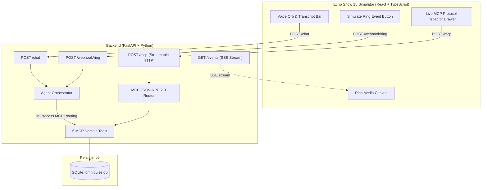

# Alexa+ OmniPulse

> **Autonomous, Context-Aware Multi-Service Ambient Orchestrator**  
> *Built for the Amazon Developer Hackathon (Alexa+ Track)*

[](https://modelcontextprotocol.io)
[](https://python.org)
[](https://fastapi.tiangolo.com)
[](https://react.dev)
[](LICENSE)

---

## 🌟 Overview

**Alexa+ OmniPulse** is a next-generation ambient AI assistant that bridges smart homes, commerce, and home security into a unified multimodal experience. A single natural voice command like:

> *"My parents are visiting tomorrow. Prep the home and find low-sodium wellness items."*

autonomously triggers sequential and parallel tool calls across **Smart Home**, **Commerce**, and **Ring Security** domains, returning natural conversational speech along with interactive rich media cards for the Echo Show 15.

### ✨ Key Capabilities
1. **MCP 2025-11-25 Streamable HTTP Server**: Complies strictly with the latest Model Context Protocol specification over `/mcp` using JSON-RPC 2.0 with both standard JSON and Server-Sent Events (SSE) support.
2. **Cross-Session Household Memory**: Persistent SQLite (`omnipulse.db`) stores user memory (e.g. *father has knee pain, prefers low-sodium Ayurvedic wellness items, warm ambient lighting*).
3. **Multi-Domain Chaining**: Automatically adjusts lighting and HVAC based on remembered preferences, searches the catalog for matching wellness items, and generates shoppable carousels with 1-click buy buttons.
4. **Proactive Ring Doorbell Verification**: Webhook at `/webhook/ring` verifies arriving guests against stored household memory (e.g. parents visiting) and auto-unlocks or alerts the homeowner via live SSE `/events`.
5. **Echo Show 15 Simulator**: Dark-mode glassmorphic interface with voice I/O (Web Speech API STT/TTS), animated Voice Orb, Rich Media Canvas, and a **Live MCP Streamable HTTP Inspector Drawer** that logs real JSON-RPC payloads in real time for judges.
6. **Zero External Dependencies Required**: Includes a deterministic smart-fallback engine so hackathon judges can clone, run, and test immediately without needing an API key. Optional support for Google Gemini, OpenAI, or AWS Bedrock can be enabled via environment variables.

---

## 🏗️ Architecture



---

## 🚀 Quickstart Guide

### Prerequisites
- [uv](https://docs.astral.sh/uv/) (Ultra-fast Python package manager)
- [Node.js](https://nodejs.org) (v18+)

---

### 1. Backend Setup & Run (using `uv`)

```bash
cd backend

# Create virtual environment and run the server
uv run uvicorn main:app --host 0.0.0.0 --port 8000 --reload
```

The backend starts at `http://localhost:8000`. SQLite `omnipulse.db` is auto-initialized and seeded with default household memory and 6 wellness products.

---

### 2. Frontend Setup & Run

```bash
cd frontend

# Install dependencies and start Vite dev server
npm install
npm run dev
```

Open `http://localhost:5173` in your browser to experience the Echo Show 15 simulator.

---

### 3. Docker Compose (1-Command Startup for Judges)

```bash
docker-compose up --build
```
- Frontend: `http://localhost:5173`
- Backend API: `http://localhost:8000`

---

## 🧪 Hackathon Verification & Testing

### Running the Full Test Suite (using `uv`)

The backend includes a comprehensive test suite of 38 unit, integration, and property-based tests verifying the 10 core architectural properties:

```bash
cd backend
uv run pytest -v
```

Output:
```text
============================= 38 passed in 7.60s ==============================
```

---

### Testing MCP 2025-11-25 Compliance via cURL / HTTPie

#### 1. MCP `initialize` Handshake
```bash
curl -X POST http://localhost:8000/mcp \
  -H "Content-Type: application/json" \
  -d '{"jsonrpc": "2.0", "id": 1, "method": "initialize"}'
```
**Expected Response:**
```json
{
  "jsonrpc": "2.0",
  "id": 1,
  "result": {
    "protocolVersion": "2025-11-25",
    "capabilities": { "tools": { "listChanged": false } },
    "serverInfo": { "name": "omnipulse-mcp", "version": "1.0.0" }
  }
}
```

#### 2. MCP `tools/list` (Exactly 6 Tools)
```bash
curl -X POST http://localhost:8000/mcp \
  -H "Content-Type: application/json" \
  -d '{"jsonrpc": "2.0", "id": 2, "method": "tools/list"}'
```

#### 3. MCP `tools/call` (Shoppable Product Carousel)
```bash
curl -X POST http://localhost:8000/mcp \
  -H "Content-Type: application/json" \
  -d '{
    "jsonrpc": "2.0",
    "id": 3,
    "method": "tools/call",
    "params": {
      "name": "search_and_build_carousel",
      "arguments": { "query": "tea", "tags": ["ayurvedic"] }
    }
  }'
```

#### 4. Multi-Domain Agent Chat
```bash
curl -X POST http://localhost:8000/chat \
  -H "Content-Type: application/json" \
  -d '{
    "message": "prep the home for parents and search low-sodium wellness items",
    "session_id": "default"
  }'
```

#### 5. Proactive Ring Doorbell Webhook
```bash
curl -X POST http://localhost:8000/webhook/ring \
  -H "Content-Type: application/json" \
  -d '{
    "event_type": "guest_arrival",
    "description": "Parents arrived at front door"
  }'
```

---

## 🛠️ MCP Tool Definitions

| Tool Name | Domain | Description |
|---|---|---|
| `get_household_memory` | Memory | Retrieves cross-session household preferences & health notes (always invoked first). |
| `save_household_memory` | Memory | Persists new user preferences and constraints for future sessions. |
| `update_smarthome_state` | Smart Home | Controls lighting (brightness, color) and thermostat (temperature, HVAC mode). |
| `search_and_build_carousel` | Commerce | Searches catalog and builds interactive Echo Show carousel cards. |
| `execute_instant_checkout` | Commerce | Executes 1-click purchase and returns order confirmation card. |
| `handle_ring_event` | Security | Evaluates Ring visitor events against expected memory and takes automated action. |

---

## 🔑 Optional LLM Integration

The demo runs completely out-of-the-box without any keys using the built-in deterministic fallback engine. If you wish to use an external LLM, set any of the following environment variables:

```bash
# Google Gemini
export GEMINI_API_KEY="your-gemini-key"

# OpenAI
export OPENAI_API_KEY="your-openai-key"

# AWS Bedrock
export AWS_ACCESS_KEY_ID="your-access-key"
export AWS_SECRET_ACCESS_KEY="your-secret-key"
export AWS_DEFAULT_REGION="us-east-1"
```

---

## 📄 License

This project is licensed under the MIT License - see the [LICENSE](LICENSE) file for details.
