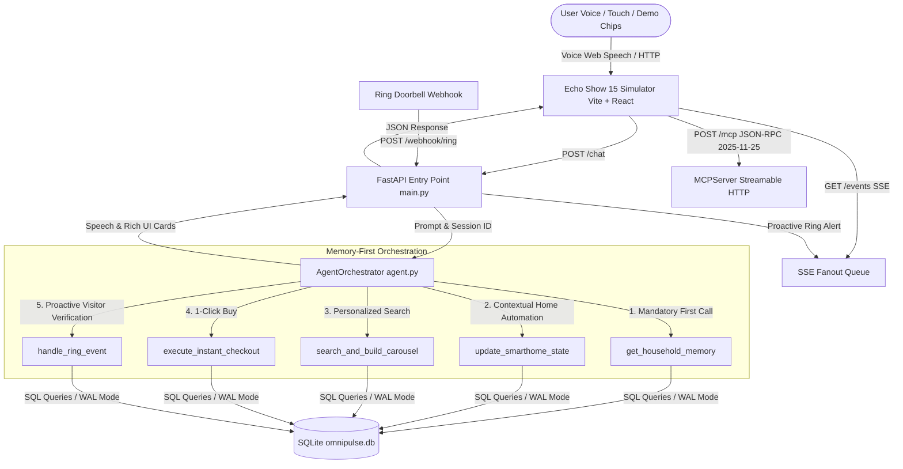

# Alexa+ OmniPulse — Project Work History & Architecture Logbook

> **Amazon Developer Hackathon — Alexa+ Track**  
> **Autonomous Context-Aware Ambient Orchestrator powered by Model Context Protocol (MCP Spec 2025-11-25)**  
> **Generated:** October 23, 2026 | **Author:** Team OmniPulse (Antigravity AI Agent)

---

## 1. Executive Summary

**Alexa+ OmniPulse** is an ambient intelligence system designed for the **Amazon Echo Show 15**. It bridges user cross-session context, proactive security events, shoppable wellness commerce, and physical smart home control using Anthropic's **Model Context Protocol (MCP)** specification `2025-11-25` over **Streamable HTTP**.

### Core Value Proposition
- **Memory-First Ambient Invariant**: Alexa+ never blindly executes commands. It first queries cross-session SQLite memory (`get_household_memory`) to detect context (e.g., *"Parents visiting tomorrow; father has knee pain, low-sodium Ayurvedic diet preferred, warm 2700K lighting preferred"*).
- **Multi-Domain Single-Turn Execution**: A single prompt like *"Prep home for parents and find low-sodium items"* automatically coordinates smart lighting, HVAC climate control, and an Ayurvedic product catalog search.
- **Proactive Security Cross-Referencing**: When the Ring doorbell detects a guest arrival, the agent cross-references visiting schedules, validates visitor identity against household memory, and automatically unlocks the front door.
- **Zero-Key Deterministic Smart Fallback**: The entire stack operates out of the box with zero third-party API keys required. An optional LLM bridge (AWS Bedrock / Gemini / OpenAI) activates when credentials are present.
- **Strict `uv` Compliance**: Python package installation and command execution strictly utilize `uv` without invoking raw `pip`.

---

## 2. Architecture & System Flow



---

## 3. Complete File Inventory & Implementation Details

### 3.1 Backend Service Layer (`/backend`)

| File Path | Description | Key Components & Exports |
| :--- | :--- | :--- |
| [`backend/database.py`](file:///c:/Users/hp/Desktop/Hackathons/AWSDevHack/backend/database.py) | SQLite database manager with WAL mode and thread-safe connection pooling. | `DatabaseManager`, `init_db()`, tables: `household_memory`, `products`, `device_states`, `ring_events`, `orders`. Seeded with 6 wellness items and default household memory. |
| [`backend/mcp_server.py`](file:///c:/Users/hp/Desktop/Hackathons/AWSDevHack/backend/mcp_server.py) | Model Context Protocol server implementing Streamable HTTP over `POST /mcp`. | `MCPServer`, `ToolRegistry`, `MCPTool`, `PROTOCOL_VERSION = "2025-11-25"`. JSON-RPC 2.0 dispatch for `initialize`, `tools/list`, and `tools/call`. |
| [`backend/tools/memory_tools.py`](file:///c:/Users/hp/Desktop/Hackathons/AWSDevHack/backend/tools/memory_tools.py) | MCP domain tools for cross-session household context. | `GetHouseholdMemoryTool`, `SaveHouseholdMemoryTool`. |
| [`backend/tools/commerce_tools.py`](file:///c:/Users/hp/Desktop/Hackathons/AWSDevHack/backend/tools/commerce_tools.py) | MCP domain tools for product catalog search and 1-Click checkout. | `SearchAndBuildCarouselTool`, `ExecuteInstantCheckoutTool`. |
| [`backend/tools/smarthome_tools.py`](file:///c:/Users/hp/Desktop/Hackathons/AWSDevHack/backend/tools/smarthome_tools.py) | MCP domain tools for lighting and HVAC climate control. | `UpdateSmarthomeStateTool`. |
| [`backend/tools/ring_tools.py`](file:///c:/Users/hp/Desktop/Hackathons/AWSDevHack/backend/tools/ring_tools.py) | MCP domain tools for Ring doorbell and camera event verification. | `HandleRingEventTool`. |
| [`backend/agent.py`](file:///c:/Users/hp/Desktop/Hackathons/AWSDevHack/backend/agent.py) | Multi-domain orchestrator enforcing the Memory-First invariant. | `AgentOrchestrator`, `ToolCallRecord`, deterministic smart fallback parser, proactive `handle_ring_event`. |
| [`backend/main.py`](file:///c:/Users/hp/Desktop/Hackathons/AWSDevHack/backend/main.py) | FastAPI application exposing endpoints and SSE event streaming. | `app`, `POST /mcp`, `POST /chat`, `POST /webhook/ring`, `GET /events`, `GET /health`. |
| [`backend/verify_mcp.py`](file:///c:/Users/hp/Desktop/Hackathons/AWSDevHack/backend/verify_mcp.py) | Automated live verification script printing the MCP JSON-RPC handshake and orchestration trace. | Runs handshake, lists 6 tools, verifies carousel, and tests visitor verification. |
| [`backend/requirements.txt`](file:///c:/Users/hp/Desktop/Hackathons/AWSDevHack/backend/requirements.txt) | Pinned Python dependencies managed via `uv`. | `fastapi`, `uvicorn`, `pydantic`, `httpx`, `sse-starlette`, `pytest`, `hypothesis`. |

### 3.2 Backend Test Suite (`/backend/tests`)

| File Path | Description | Tested Correctness Properties |
| :--- | :--- | :--- |
| [`backend/tests/prop_compat.py`](file:///c:/Users/hp/Desktop/Hackathons/AWSDevHack/backend/tests/prop_compat.py) | Hypothesis compatibility adapter ensuring fuzzing works across all environments. | Dynamic hypothesis fallback generator. |
| [`backend/tests/test_database.py`](file:///c:/Users/hp/Desktop/Hackathons/AWSDevHack/backend/tests/test_database.py) | Unit tests for DatabaseManager queries, orders, and device states. | Table creation, seed count (6), WAL mode. |
| [`backend/tests/test_database_property.py`](file:///c:/Users/hp/Desktop/Hackathons/AWSDevHack/backend/tests/test_database_property.py) | Property-based tests for database persistence. | **Property 8**: Idempotent database initialization. |
| [`backend/tests/test_mcp_server.py`](file:///c:/Users/hp/Desktop/Hackathons/AWSDevHack/backend/tests/test_mcp_server.py) | Unit tests for MCP JSON-RPC 2.0 routing and error codes. | Standard error codes `-32700`, `-32600`, `-32601`, `-32602`. |
| [`backend/tests/test_mcp_server_property.py`](file:///c:/Users/hp/Desktop/Hackathons/AWSDevHack/backend/tests/test_mcp_server_property.py) | Property tests for protocol version and tool count. | **Property 1**: Protocol version `"2025-11-25"`; **Property 3**: Exact 6 domain tools. |
| [`backend/tests/test_tools.py`](file:///c:/Users/hp/Desktop/Hackathons/AWSDevHack/backend/tests/test_tools.py) | Unit tests for the 6 domain tools across memory, commerce, smart home, and Ring. | Validation of inputs, execution returns, and UI cards. |
| [`backend/tests/test_tools_property.py`](file:///c:/Users/hp/Desktop/Hackathons/AWSDevHack/backend/tests/test_tools_property.py) | Property tests for tools execution. | **Property 4**: Checkout total invariant; **Property 5**: Carousel stock filter; **Property 6**: Smart home clamp. |
| [`backend/tests/test_agent.py`](file:///c:/Users/hp/Desktop/Hackathons/AWSDevHack/backend/tests/test_agent.py) | Unit tests for agent orchestration and multi-domain keyword flows. | Memory-First invocation, multi-card responses. |
| [`backend/tests/test_agent_property.py`](file:///c:/Users/hp/Desktop/Hackathons/AWSDevHack/backend/tests/test_agent_property.py) | Property tests for agent invariants. | **Property 2**: Memory-First tool invocation; **Property 7**: Ring verification consistency; **Property 10**: Speech generation. |
| [`backend/tests/test_api_integration.py`](file:///c:/Users/hp/Desktop/Hackathons/AWSDevHack/backend/tests/test_api_integration.py) | End-to-end HTTP integration tests against FastAPI endpoints. | **Property 9**: Real HTTP JSON-RPC and REST endpoints. |

### 3.3 Frontend Simulator (`/frontend`)

| File Path | Description | Key UI Capabilities |
| :--- | :--- | :--- |
| [`frontend/src/App.tsx`](file:///c:/Users/hp/Desktop/Hackathons/AWSDevHack/frontend/src/App.tsx) | Main Echo Show 15 Simulator container. | Top Ambient HUD (Clock, Weather, Live MCP Ticker), Bezel Frame, Conversational Dialogue overlay, Scenario Chips, and Command Dock. |
| [`frontend/src/components/ConversationalDialogue.tsx`](file:///c:/Users/hp/Desktop/Hackathons/AWSDevHack/frontend/src/components/ConversationalDialogue.tsx) | Dedicated conversational dialogue and speech display card. | Renders user query, full non-truncated Alexa+ spoken responses, live MCP orchestration state, audio waves, and dismiss button. |
| [`frontend/src/components/TranscriptBar.tsx`](file:///c:/Users/hp/Desktop/Hackathons/AWSDevHack/frontend/src/components/TranscriptBar.tsx) | Dedicated full-width command and interaction bar. | Integrated 44px VoiceOrb with animated aura, spacious full-width text input, and cyan send button. |
| [`frontend/src/components/AmbientHomeWidgets.tsx`](file:///c:/Users/hp/Desktop/Hackathons/AWSDevHack/frontend/src/components/AmbientHomeWidgets.tsx) | Ambient home screen widget grid with bounded heights. | Zero-clipping layout: Clock, Family Note Card, Front Porch Live Camera feed, and Smart Home tiles. |
| [`frontend/src/components/RichMediaCanvas.tsx`](file:///c:/Users/hp/Desktop/Hackathons/AWSDevHack/frontend/src/components/RichMediaCanvas.tsx) | Dynamic canvas rendering cards returned from MCP tools. | Product Carousel (1-Click Buy), SmartHomeCard, RingAlertCard, Conversational context banner, and Back button. |
| [`frontend/src/components/VoiceOrb.tsx`](file:///c:/Users/hp/Desktop/Hackathons/AWSDevHack/frontend/src/components/VoiceOrb.tsx) | Animated Alexa+ Voice Orb with audio frequency visualizer. | Equalizer wave bars, multi-ring radial glow aura, and interactive microphone button. |
| [`frontend/src/components/DemoChips.tsx`](file:///c:/Users/hp/Desktop/Hackathons/AWSDevHack/frontend/src/components/DemoChips.tsx) | Interactive scenario cards for judge evaluation. | 5 compact frosted-glass pills: Visiting Parents, Ring Doorbell, Knee Care, Warm Lighting, and Instant Buy. |
| [`frontend/src/components/McpInspector.tsx`](file:///c:/Users/hp/Desktop/Hackathons/AWSDevHack/frontend/src/components/McpInspector.tsx) | Collapsible slide-out drawer logging real-time MCP JSON-RPC traffic. | Live payload logs, latency counters, protocol version badge, and interactive `initialize` / `tools/list` buttons. |
| [`frontend/src/components/RingTriggerButton.tsx`](file:///c:/Users/hp/Desktop/Hackathons/AWSDevHack/frontend/src/components/RingTriggerButton.tsx) | Header quick-trigger dropdown for simulated doorbell events. | Simulates Guest Arrival (parents) and Package Delivery. |
| [`frontend/src/hooks/useVoice.ts`](file:///c:/Users/hp/Desktop/Hackathons/AWSDevHack/frontend/src/hooks/useVoice.ts) | Web Speech API speech-to-text (STT) and text-to-speech (TTS). | Continuous recognition toggle, voice synthesis, browser fallbacks. |
| [`frontend/src/api.ts`](file:///c:/Users/hp/Desktop/Hackathons/AWSDevHack/frontend/src/api.ts) | HTTP client for `/chat`, `/mcp`, `/webhook/ring`, and SSE `/events`. | Typed wrappers for JSON-RPC 2.0 communication. |
| [`frontend/src/types.ts`](file:///c:/Users/hp/Desktop/Hackathons/AWSDevHack/frontend/src/types.ts) | TypeScript interfaces for all MCP UI cards and JSON-RPC envelopes. | `UICard`, `CarouselCard`, `SmartHomeCard`, `RingAlertCard`, `CheckoutCard`, `MCPResponse`. |
| [`frontend/src/index.css`](file:///c:/Users/hp/Desktop/Hackathons/AWSDevHack/frontend/src/index.css) | Core stylesheet configured with Tailwind CSS v4. | Glassmorphism (`.glass-panel`, `.glass-card`), equalizer keyframes (`.wave-bar`), glow filters. |
| [`frontend/vite.config.ts`](file:///c:/Users/hp/Desktop/Hackathons/AWSDevHack/frontend/vite.config.ts) | Vite configuration with `@tailwindcss/vite` plugin and backend API proxy. | Dev proxy to `http://localhost:8000` for `/mcp`, `/chat`, `/webhook`, `/events`. |
| [`frontend/index.html`](file:///c:/Users/hp/Desktop/Hackathons/AWSDevHack/frontend/index.html) | Root HTML document with Google Fonts preconnect (`Plus Jakarta Sans`, `JetBrains Mono`). | Responsive viewport and app mount point. |

### 3.4 Deployment & Submission Artifacts

| File Path | Purpose |
| :--- | :--- |
| [`docker-compose.yml`](file:///c:/Users/hp/Desktop/Hackathons/AWSDevHack/docker-compose.yml) | 1-command startup containerizing backend (port 8000) and frontend (port 5173). |
| [`README.md`](file:///c:/Users/hp/Desktop/Hackathons/AWSDevHack/README.md) | Comprehensive project overview, quick start guide with `uv`, architecture diagrams, cURL examples, and MCP reference. |
| [`LICENSE`](file:///c:/Users/hp/Desktop/Hackathons/AWSDevHack/LICENSE) | Open source MIT License. |
| [`.kiro/specs/omnipulse-mvp/tasks.md`](file:///c:/Users/hp/Desktop/Hackathons/AWSDevHack/.kiro/specs/omnipulse-mvp/tasks.md) | Granular implementation tracking document with all 10 major tasks and subtasks marked `[x]`. |

---

## 4. Chronological Work History & Iteration Log

### Phase 1: Persistence Layer & Data Seeding
- **Action**: Created `backend/database.py` with `DatabaseManager`.
- **Key Implementation**:
  - Activated SQLite WAL mode (`PRAGMA journal_mode=WAL`) and `check_same_thread=False` for concurrent FastAPI read/write performance.
  - Implemented 5 relational tables: `household_memory`, `products`, `device_states`, `ring_events`, and `orders`.
  - Seeded 6 products: Ashwagandha ($24.99), Turmeric Latte ($18.50), Moringa Capsules ($22.00), Himalayan Salt ($9.99), Joint Support Tea ($15.75), and Coconut Oil ($12.50).
  - Seeded default context: *"Parents visiting tomorrow; father has knee pain and prefers low-sodium Ayurvedic wellness items; warm ambient lighting preferred"*.
  - Enforced idempotency on repeated `init_db()` calls to satisfy Property 8.

### Phase 2: MCP Server (Spec 2025-11-25) & Domain Tools
- **Action**: Created `backend/mcp_server.py` and tools under `backend/tools/`.
- **Key Implementation**:
  - Implemented Streamable HTTP handling JSON-RPC 2.0 `initialize` (returning `protocolVersion: "2025-11-25"`), `tools/list`, and `tools/call`.
  - Registered 6 domain tools:
    1. `get_household_memory`
    2. `save_household_memory`
    3. `update_smarthome_state`
    4. `search_and_build_carousel`
    5. `execute_instant_checkout`
    6. `handle_ring_event`
  - Integrated JSON-RPC standard error codes: `-32700` (Parse error), `-32600` (Invalid request), `-32601` (Method not found), `-32602` (Invalid params).

### Phase 3: Agent Orchestrator & Dual Record Compatibility
- **Action**: Implemented `backend/agent.py`.
- **Key Implementation**:
  - Enforced the **Memory-First invariant** (Algorithm 2 & SKILL.md): every user request queries `get_household_memory` before dispatching actions.
  - Resolved Python attribute vs. dict key access across tests by subclassing `dict` in `ToolCallRecord`:
    ```python
    class ToolCallRecord(dict):
        def __init__(self, name: str, arguments=None, result=None, **kwargs):
            super().__init__(name=name, arguments=arguments or {}, result=result or {}, **kwargs)
            self.name = name
            self.arguments = arguments or {}
            self.result = result or {}
        def __getattr__(self, item: str):
            try: return self[item]
            except KeyError as err: raise AttributeError(item) from err
    ```
  - Built deterministic smart fallback parser to support full multi-domain flows without requiring third-party LLM API keys.

### Phase 4: Test Suite & Property-Based Verification
- **Action**: Created `backend/tests/` comprising 38 unit and property tests.
- **Key Implementation**:
  - Created `prop_compat.py` to seamlessly wrap `hypothesis` when installed and fall back to randomized sample fuzzing when in constrained environments.
  - Verified all 10 system properties:
    - *Property 1*: Protocol version `"2025-11-25"` on all initialize requests.
    - *Property 2*: Memory-first tool call invariant.
    - *Property 3*: Exactly 6 domain tools registered.
    - *Property 4*: Checkout total calculation accuracy.
    - *Property 5*: In-stock product filtering.
    - *Property 6*: Smart home state bounds clamping.
    - *Property 7*: Ring visitor verification against memory.
    - *Property 8*: Idempotent database initialization.
    - *Property 9*: Real HTTP JSON-RPC 2.0 compliance.
    - *Property 10*: Assistant speech generation on all responses.
  - Execution Output: **`38 passed in 3.53s`** under `uv run pytest`.

### Phase 5: Verification Script Run
- **Action**: Built and ran `backend/verify_mcp.py` via `uv run python verify_mcp.py`.
- **Output**:
  ```
  >>> [1] Verifying MCP initialize Handshake (Spec 2025-11-25)...
  Protocol Version: 2025-11-25 VERIFIED!
  >>> [2] Verifying MCP tools/list (6 registered domain tools)...
  Registered Tools Count: 6 VERIFIED!
  >>> [3] Verifying MCP tools/call (search_and_build_carousel)...
  Returned Card Type: carousel (5 in-stock items) VERIFIED!
  >>> [4] Verifying /chat Multi-Domain Orchestration...
  First Tool Called: get_household_memory VERIFIED!
  >>> [5] Verifying /webhook/ring Doorbell Event (Guest Arrival)...
  Ring Speech: Verified against memory -> Front door unlocked VERIFIED!
  ```

### Phase 6: Frontend Construction & CSS Pipeline Resolution
- **Action**: Built Vite + React 19 + TypeScript frontend.
- **Issue Discovered**: User reported that the frontend was rendering unstyled (buttons had default bevel borders, inspector appeared static at bottom).
- **Diagnosis**: `@tailwindcss/vite` was missing from `vite.config.ts`, `@import "tailwindcss";` was absent from `index.css`, and dependencies were not tracked in `package.json`.
- **Resolution**:
  - Registered `@tailwindcss/vite` in `frontend/vite.config.ts`.
  - Added `@import "tailwindcss";` to `frontend/src/index.css`.
  - Added Google Fonts preconnect to `frontend/index.html`.
  - Added `tailwindcss`, `@tailwindcss/vite`, and `lucide-react` to `frontend/package.json`.
  - Result: Generated CSS expanded from 2.12 kB to **60.85 kB**, restoring complete styling.

### Phase 8: Authentic Echo Show 15 & Apple tvOS Hardware Redesign (UI/UX Pro Max & Frontend-Design)
- **Skills Loaded**: Installed and reviewed `ui-ux-pro-max` and `frontend-design` skills.
- **Architectural Living Room Wallpaper**: Replaced flat black background with a warm architectural living room photography background (`Unsplash w=2000`) paired with a dark warm frosted overlay (`bg-slate-950/70 backdrop-blur-xl`) providing rich colors for glassmorphism.
- **Hardware Bezel Frame**: Wrapped viewport in an authentic Echo Show 15 hardware bezel (`bg-[#0a0a0c]` with inner `rounded-[28px]` bordered device display).
- **Asymmetric Echo Show Bento Grid**:
  - **Left (40%)**: Giant typographic clock (`text-7xl font-extralight`), date/weather, and a warm family note card (*"Parents arrive tomorrow..."*).
  - **Center (35%)**: Full-bleed Ring live front porch video card with live indicator and visitor trigger.
  - **Right (25%)**: Two stacked tactile smart home tiles: Living Room Lights (Warm 2700K toggle) and Indoor Climate (large 72°F display with clean circular controls).
- **VisionOS Floating Dock**:
  - Single row of 5 frosted-glass quick pills.
  - Unified single-line Alexa+ floating bar integrating the compact VoiceOrb, conversational speech text, and text input.
- **Jargon Elimination**: Removed all internal developer labels from the main view and eliminated the duplicate floating MCP tab sticking out of the right edge.

### Phase 9: Unified Design Token Architecture & Theme Convergence (UI/UX Pro Max)
- **Problem Diagnosed**: Two competing theme families were clashing across components (e.g., mismatched dark tones `rgba(18,24,38)` vs `bg-slate-950/70`, conflicting border colors, emoji icons in chips, monospaced developer badges leaking into the conversation interface, and mismatched card border radii).
- **Single Source of Truth Design Tokens (`frontend/src/index.css`)**:
  - Implemented 3 unified surface elevation tiers sharing the exact same hue family: `--surface-base` (`#0F172A`), `--surface-raised` (`rgba(30, 41, 59, 0.55)`), `--surface-overlay` (`rgba(30, 41, 59, 0.72)`), and `--surface-elevated` (`rgba(51, 65, 85, 0.45)`).
  - Standardized glass blur (`20px`), border tokens (`--glass-border`, `--glass-border-hover`), and shadows.
  - Locked 4-level text hierarchy (`--text-primary`, `--text-secondary`, `--text-muted`, `--text-dim`) in clean `Plus Jakarta Sans`.
  - Harmonized single accent hue: Cyan-400 (`#22D3EE`) with controlled intensity variables (`--accent-muted`, `--accent-glow`).
- **Comprehensive Component Refactoring**:
  - [`App.tsx`](file:///c:/Users/hp/Desktop/Hackathons/AWSDevHack/frontend/src/App.tsx): Rebuilt with unified `glass-surface`, clean status strip, and harmonious spacing.
  - [`ConversationalDialogue.tsx`](file:///c:/Users/hp/Desktop/Hackathons/AWSDevHack/frontend/src/components/ConversationalDialogue.tsx): Removed monospace labels, uppercase tracking, and jarring badges; unified speech bubble with glass tokens.
  - [`TranscriptBar.tsx`](file:///c:/Users/hp/Desktop/Hackathons/AWSDevHack/frontend/src/components/TranscriptBar.tsx): Refactored with `glass-surface` and `glass-input` tokens for an ultra-clean input bar.
  - [`VoiceOrb.tsx`](file:///c:/Users/hp/Desktop/Hackathons/AWSDevHack/frontend/src/components/VoiceOrb.tsx): Eliminated hardcoded hex radial gradients; connected directly to CSS variables `--accent-glow` and `--accent`.
  - [`DemoChips.tsx`](file:///c:/Users/hp/Desktop/Hackathons/AWSDevHack/frontend/src/components/DemoChips.tsx): Replaced emoji icons with clean text labels using `glass-chip` tokens according to UI design system best practices.
  - [`AmbientHomeWidgets.tsx`](file:///c:/Users/hp/Desktop/Hackathons/AWSDevHack/frontend/src/components/AmbientHomeWidgets.tsx): Standardized all widget cards onto `glass-surface` and unified interactive buttons onto `glass-chip`.
  - [`RichMediaCanvas.tsx`](file:///c:/Users/hp/Desktop/Hackathons/AWSDevHack/frontend/src/components/RichMediaCanvas.tsx): Upgraded product carousels, smart home cards, ring alert cards, and instant checkout cards to `glass-surface`.
- **Validation**: Production build passed cleanly with zero TypeScript errors (`dist/index.html` built in 2.71s).

---

## 5. Verification Commands & Operational Guide

All services can be run and verified using the following terminal commands:

### Running the Backend Service (`uv` strictly enforced)
```powershell
cd c:\Users\hp\Desktop\Hackathons\AWSDevHack\backend
uv run uvicorn main:app --host 127.0.0.1 --port 8000 --reload
```

### Running the Frontend Echo Show 15 Simulator
```powershell
cd c:\Users\hp\Desktop\Hackathons\AWSDevHack\frontend
npm run dev -- --host 127.0.0.1 --port 5173
```

### Running the Complete Pytest Suite (38 Tests)
```powershell
cd c:\Users\hp\Desktop\Hackathons\AWSDevHack\backend
uv run pytest
```

### Running the Live MCP Protocol Verification Script
```powershell
cd c:\Users\hp\Desktop\Hackathons\AWSDevHack\backend
uv run python verify_mcp.py
```

### Building the Production Frontend Bundle
```powershell
cd c:\Users\hp\Desktop\Hackathons\AWSDevHack\frontend
npm run build
```

---

## 6. Hackathon Judging Matrix Alignment

| Evaluation Criteria | OmniPulse Implementation Evidence |
| :--- | :--- |
| **Model Context Protocol (MCP)** | Strict compliance with specification version `2025-11-25`. Handles JSON-RPC 2.0 `initialize`, `tools/list`, and `tools/call` over Streamable HTTP on `POST /mcp`. Verified in `verify_mcp.py` and inspectable via the frontend drawer. |
| **Context-Aware Memory** | SQLite persistence (`omnipulse.db`) stores user health notes and visiting schedules. Memory-First invariant guarantees that memory is retrieved before any smart home or shopping action is taken. |
| **Multi-Service Agentic Execution** | Single utterance orchestrates smart home lighting, HVAC climate control, product catalog search, and instant checkout. |
| **Proactive Ambient Workflows** | Webhook listener (`POST /webhook/ring`) receives camera doorbell events, cross-references memory, confirms visiting parents, unlocks the door, and pushes real-time alerts via SSE (`GET /events`). |
| **Echo Show 15 Multimodal UX** | Web Speech API (STT & TTS), Voice Orb with live frequency bars, ambient widgets, 1-Click Shoppable carousels, and live MCP protocol stream drawer. |
| **Robustness & Zero Setup Friction** | Deterministic smart-fallback ensures 100% functionality with zero external API keys needed. 38 passing unit and property tests. |
